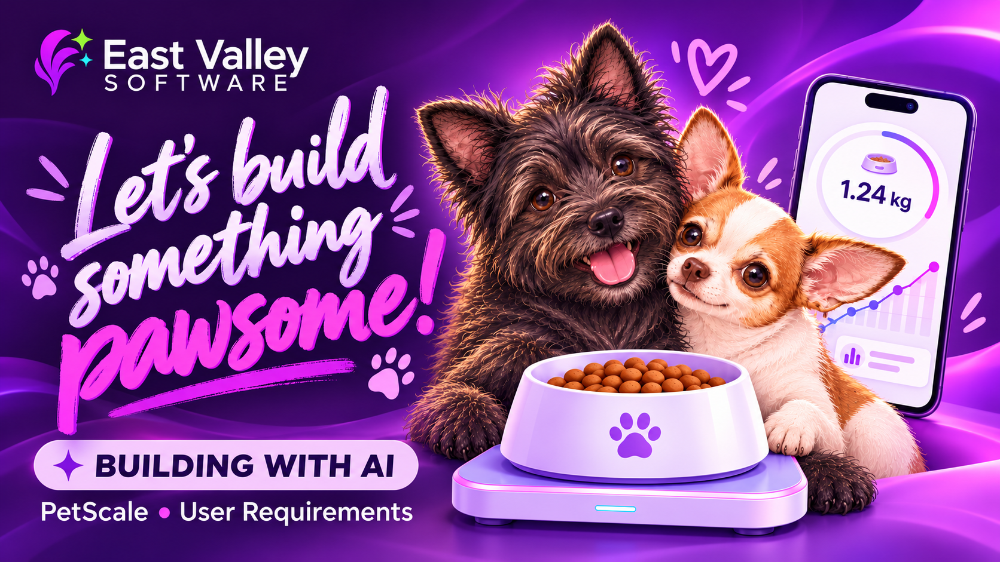

# Build a Smart Pet Bowl Monitor

A build series from **Sarah Brenner at East Valley Software**, exploring how to use AI throughout a real connected-device project while keeping engineering decisions and review in human hands.

We’re building a pet bowl scale that connects over Bluetooth Low Energy to a mobile app, helping owners measure food for each meal and keep a history of prepared portions.

## Watch Part 1 — Introduction and Setup

**[Watch Part 1 on YouTube](https://youtu.be/mQdOCcSmR1g)**

In the first video, we start with the product idea and work through user requirements, hazard considerations, technical specifications, and system architecture. I share where AI helped, where it made assumptions, and why careful questions and human review still matter. We also meet the hardware: a Nordic nRF52840 board and an M5Stack Mini Scales unit.

## Documents from the video

The Word documents are in [`documents/`](documents/):

| Document | What you’ll find |
| --- | --- |
| [User requirements](documents/user-requirements.docx) | Product scope, user workflows, requirements, acceptance criteria, and a traceability map. |
| [Hazard considerations](documents/hazards-to-consider.docx) | Possible failures and consequences, linked to the requirements intended to address them. |
| [Technical specification](documents/technical-specification.docx) | Hardware, firmware, Android, storage, and operating constraints. |
| [System architecture](documents/system-architecture.docx) | The main components, their responsibilities, and how information moves between them. |

These documents will evolve as the project develops. They describe intended behavior and design; they are not evidence that every feature has been implemented or tested. ISO requirements-engineering and risk-management principles are learning references for this series, without a claim of compliance.

## Try the prompts in your own project

The two prompts promised in the video are in [`prompts/`](prompts/). Use them in separate AI tasks:

1. **[Develop the user requirements](prompts/01-develop-user-requirements.md)** — describe your project and attach the example requirements document as a reference for structure and detail.
2. **[Examine hazards](prompts/02-examine-hazards.md)** — attach your resulting requirements and the example hazard document to explore possible failures and gaps.

Work through your own product decisions, review the suggestions, and adapt the examples to your project. And yes, you’re welcome to change the purples and pinks.
